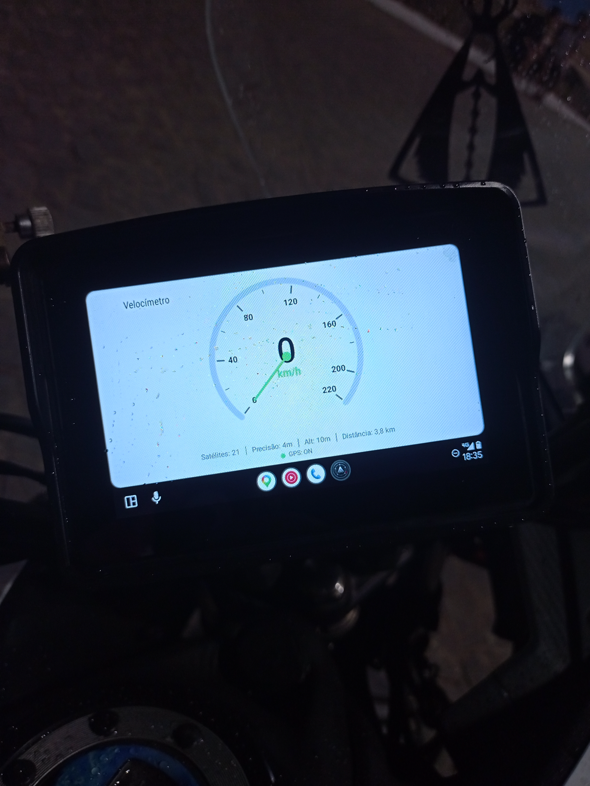
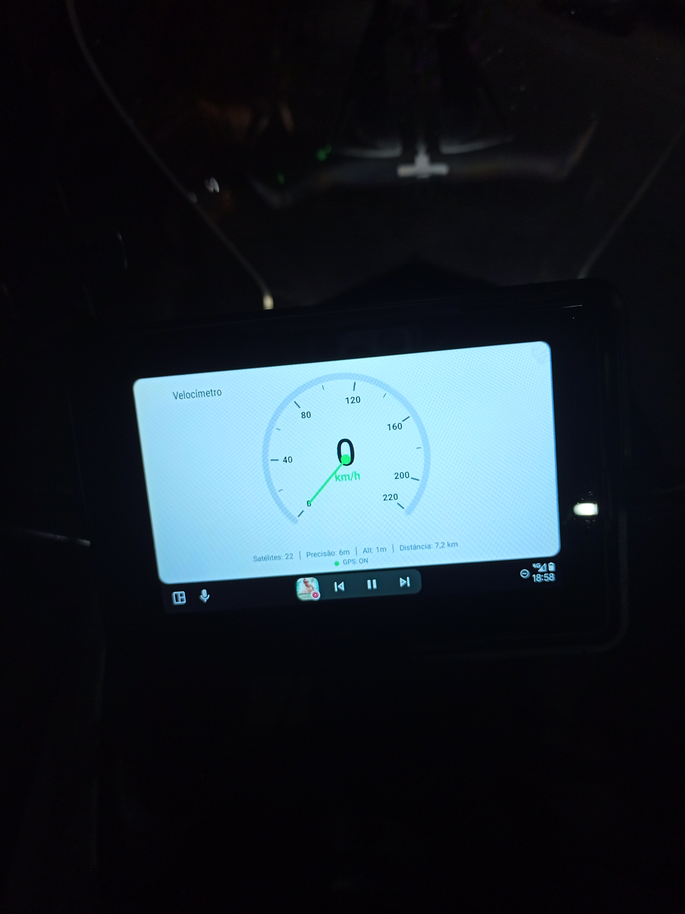

# Velocímetro GPS para Android e Android Auto

Um velocímetro GPS moderno, minimalista e de alta legibilidade projetado para **Android** e **Android Auto**, capaz de renderizar dashboards gráficos personalizados diretamente na tela da central multimídia do veículo sem depender de templates genéricos.

> [!NOTE]
> **100% Independente**: Funciona exclusivamente com o módulo GPS/GNSS nativo do smartphone. Não necessita de adaptadores OBD2, ELM327, nem do aplicativo Torque Pro.

---

## 🌟 Funcionalidades

- **Interface Gráfica Customizada**: Mostrador circular graduado de 0 a 220 km/h (configurável até 240 km/h) com indicador de velocidade digital central em alta visibilidade.
- **Integração Nativa com Android Auto**: Baseado na arquitetura de projeção do **AA Torque** (`CarActivityService` / `CarActivity`), desenhando a interface nativa em canvas direto na tela do carro.
- **Filtro de Leitura GPS**: Filtro de Média Móvel Exponencial (EMA) para eliminar oscilações e jitter do sinal GNSS mantendo resposta imediata.
- **Painel Secundário Discreto**: Exibição de estatísticas complementares sem competir visualmente com a velocidade:
  - Status da conexão GPS (●)
  - Quantidade de satélites ativos
  - Precisão da localização em metros
  - Altitude atual
  - Odômetro/Distância da viagem
- **Suporte a Temas**: Modo Claro, Modo Escuro e Modo Automático (acompanhando o sistema/carro).
- **Gerenciador de Preferências**: Opções para alterar velocidade máxima, nível de suavização, unidades (`km/h` ou `mph`) e manter tela ligada.

---

## 📱 Como Instalar no Android (Compatibilidade Android Auto)

Para que aplicativos de terceiros não publicados na Google Play Store apareçam no launcher da central multimídia do **Android Auto**, é recomendável realizar a instalação utilizando o **KingInstaller**. O KingInstaller registra a instalação simulando a fonte da loja oficial, permitindo que o Android Auto reconheça o aplicativo.

### Passo 1: Habilitar o Modo de Desenvolvedor no Android Auto

1. No smartphone, abra as **Configurações** do Android e procure por **Android Auto**.
2. Role até o final da tela até a seção **Versão**.
3. Toque **7 vezes consecutivas** sobre o número da versão até aparecer a mensagem *"Você agora é um desenvolvedor"*.
4. No canto superior direito, toque no menu de três pontos (⋮) e selecione **Configurações de desenvolvedor**.
5. Marque a opção **Fontes desconhecidas** (*Unknown sources*).

---

### Passo 2: Instalação via KingInstaller

1. Baixe o APK mais recente do **KingInstaller** no repositório oficial do GitHub:
   👉 [https://github.com/fcaronte/KingInstaller/releases](https://github.com/fcaronte/KingInstaller/releases)
2. Instale o APK do **KingInstaller** no smartphone e conceda as permissões de acesso aos arquivos solicitadas.
3. Baixe o APK do **Velocímetro GPS** (`app-debug.apk` ou `app-release.apk`) no seu dispositivo.
4. Abra o **KingInstaller**:
   - Toque em **Select file...** e escolha o arquivo APK do Velocímetro GPS.
   - Certifique-se de que as opções adicionais (como *Enable King root method* se aplicável, ou opções de instalação como Google Play) estejam configuradas conforme as instruções do KingInstaller.
   - Toque no botão **Install as king**.
5. Conceda a permissão do instalador de pacotes do Android e conclua a instalação.

---

### Passo 3: Execução e Conexão ao Veículo

1. Abra o aplicativo **Velocímetro GPS** no celular pela primeira vez e conceda as permissões de **Localização**.
2. Conecte o smartphone à central multimídia via cabo USB ou Wi-Fi (Android Auto).
3. No launcher do Android Auto no carro, localize o ícone **Velocímetro** e toque para abrir o dashboard em tela cheia.

---

## 🏗️ Compilação do Código Fonte

### Pré-requisitos
- JDK 17
- Android SDK (API 34 / minSdk 28)
- Gradle 8.2+

### Comandos de Build

```bash
# Clocar o repositório
git clone https://github.com/seu-usuario/aa_velocimetro.git
cd aa_velocimetro

# Compilar APK de Depuração
./gradlew assembleDebug

# O APK gerado estará em:
# app/build/outputs/apk/debug/app-debug.apk
```

---

## 🏛️ Arquitetura e Atribuições

Este projeto foi construído adaptando a infraestrutura de projeção do projeto open-source [AA Torque](https://github.com/agronick/aa-torque), licenciado sob a **GNU General Public License v3.0 (GPL-3.0)**.

- **`AutoService`**: Extende `CarActivityService` (`com.google.android.apps.auto.sdk`).
- **`AutoSpeedometerActivity`**: Extende `CarActivity` para gerenciar a janela virtual da multimídia.
- **`SpeedRepository`**: Canal de estado reativo unificado (`StateFlow`) fornecendo dados sincronizados para o celular e a tela do veículo.

### Imagem real no display da multimidia lelong LE-6336 espelhamento via android auto sem fio

<p align="center">
  
</p>
<p align="center">
  
</p>


### Licença
Este software é distribuído sob os termos da licença **GNU General Public License v3.0 (GPL-3.0)**.
